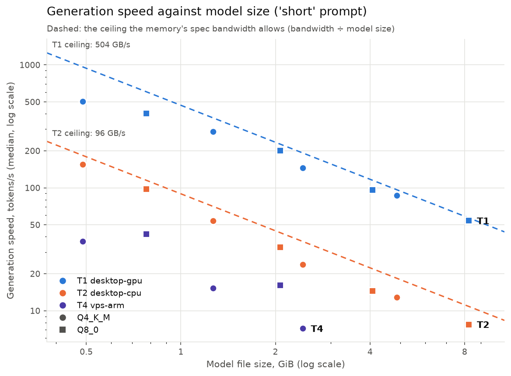
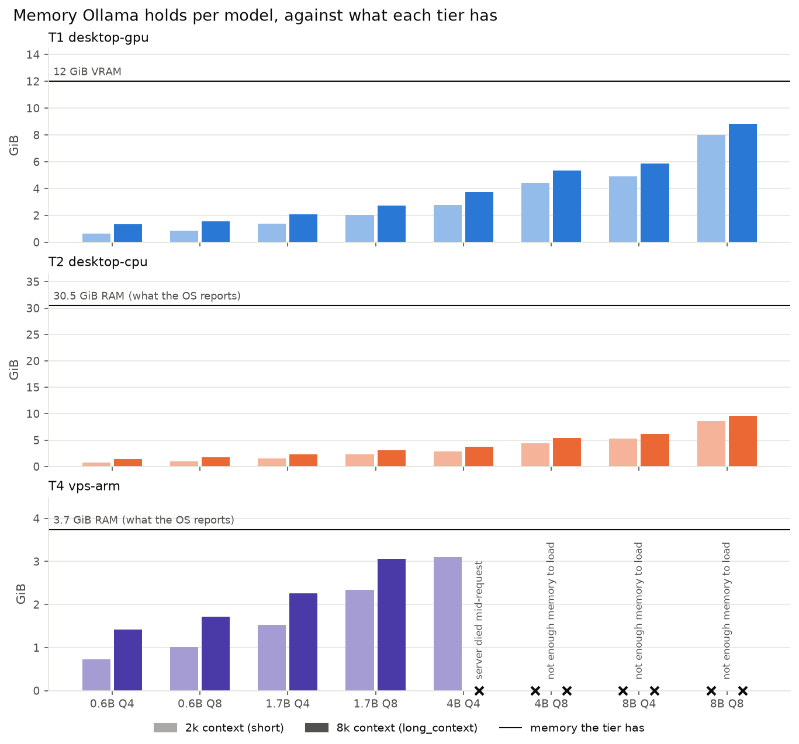

# Results

Generated by `llm-bench report` from the files in `results/`. Do not edit by hand:
re-run the command.

Every number is the median over the measured repetitions; the warmup request is left
out. TTFT is measured by the client, from sending the request to the first streamed
token. Sizes are GiB (1024³ bytes). GPU is the share of Ollama's loaded memory held in
VRAM: below 100 % on a GPU tier means the model was split with system RAM.

## T1 · desktop-gpu

AMD Ryzen 7 9800X3D 8-Core Processor · NVIDIA GeForce RTX 4070, 615.71.09, 12282 MiB · 30.5 GiB RAM · Linux 7.2.8-1-cachyos · Ollama 0.34.4 · harness e83569f · started 2026-10-10 20:24 UTC · `results/T1-20261010T202451Z.jsonl`

| Model | Regime | Measured | TTFT ms | Prompt tok/s | Gen tok/s | Loaded GiB | GPU | Failure |
|---|---|---:|---:|---:|---:|---:|---:|---|
| qwen3-0.6b-q4 | short | 10/10 | 6.08 | 7,633 | 503 | 0.65 | 100% |  |
| qwen3-0.6b-q4 | long_context | 10/10 | 92.9 | 35,830 | 348 | 1.34 | 100% |  |
| qwen3-0.6b-q4 | structured | 10/10 | 17.3 | 16,623 | 482 | 0.65 | 100% |  |
| qwen3-0.6b-q8 | short | 10/10 | 6.58 | 7,050 | 405 | 0.86 | 100% |  |
| qwen3-0.6b-q8 | long_context | 10/10 | 90.6 | 36,757 | 325 | 1.56 | 100% |  |
| qwen3-0.6b-q8 | structured | 10/10 | 17.1 | 16,688 | 427 | 0.86 | 100% |  |
| qwen3-1.7b-q4 | short | 10/10 | 8.42 | 5,015 | 287 | 1.36 | 100% |  |
| qwen3-1.7b-q4 | long_context | 10/10 | 174 | 18,061 | 231 | 2.08 | 100% |  |
| qwen3-1.7b-q4 | structured | 10/10 | 20.9 | 13,578 | 288 | 1.36 | 100% |  |
| qwen3-1.7b-q8 | short | 10/10 | 9.42 | 4,267 | 201 | 2.02 | 100% |  |
| qwen3-1.7b-q8 | long_context | 10/10 | 169 | 18,607 | 173 | 2.74 | 100% |  |
| qwen3-1.7b-q8 | structured | 10/10 | 20.9 | 13,500 | 201 | 2.02 | 100% |  |
| qwen3-4b-q4 | short | 10/10 | 14.6 | 2,602 | 145 | 2.79 | 100% |  |
| qwen3-4b-q4 | long_context | 10/10 | 398 | 7,588 | 122 | 3.72 | 100% |  |
| qwen3-4b-q4 | structured | 10/10 | 41.3 | 6,567 | 143 | 2.79 | 100% |  |
| qwen3-4b-q8 | short | 10/10 | 17.6 | 2,047 | 96.4 | 4.42 | 100% |  |
| qwen3-4b-q8 | long_context | 10/10 | 382 | 7,901 | 84.9 | 5.35 | 100% |  |
| qwen3-4b-q8 | structured | 10/10 | 39.8 | 6,809 | 94.0 | 4.42 | 100% |  |
| qwen3-8b-q4 | short | 10/10 | 21.8 | 1,631 | 86.9 | 4.91 | 100% |  |
| qwen3-8b-q4 | long_context | 10/10 | 644 | 4,640 | 77.8 | 5.86 | 100% |  |
| qwen3-8b-q4 | structured | 10/10 | 66.2 | 3,997 | 87.4 | 4.91 | 100% |  |
| qwen3-8b-q8 | short | 10/10 | 27.8 | 1,262 | 54.2 | 8.00 | 100% |  |
| qwen3-8b-q8 | long_context | 10/10 | 621 | 4,809 | 50.6 | 8.85 | 100% |  |
| qwen3-8b-q8 | structured | 10/10 | 66.6 | 3,994 | 54.1 | 8.00 | 100% |  |

## T2 · desktop-cpu

AMD Ryzen 7 9800X3D 8-Core Processor · NVIDIA GeForce RTX 4070, 615.71.09, 12282 MiB · 30.5 GiB RAM · Linux 7.2.8-1-cachyos · Ollama 0.34.4 · harness e83569f · started 2026-10-10 20:29 UTC · `results/T2-20261010T202958Z.jsonl`

| Model | Regime | Measured | TTFT ms | Prompt tok/s | Gen tok/s | Loaded GiB | GPU | Failure |
|---|---|---:|---:|---:|---:|---:|---:|---|
| qwen3-0.6b-q4 | short | 10/10 | 25.9 | 1,376 | 155 | 0.73 | 0% |  |
| qwen3-0.6b-q4 | long_context | 10/10 | 2,336 | 1,263 | 71.6 | 1.42 | 0% |  |
| qwen3-0.6b-q4 | structured | 10/10 | 145 | 1,802 | 138 | 0.73 | 0% |  |
| qwen3-0.6b-q8 | short | 10/10 | 34.9 | 1,006 | 98.4 | 1.02 | 0% |  |
| qwen3-0.6b-q8 | long_context | 10/10 | 2,960 | 996 | 57.4 | 1.71 | 0% |  |
| qwen3-0.6b-q8 | structured | 10/10 | 193 | 1,354 | 91.5 | 1.02 | 0% |  |
| qwen3-1.7b-q4 | short | 10/10 | 58.5 | 582 | 53.7 | 1.53 | 0% |  |
| qwen3-1.7b-q4 | long_context | 10/10 | 5,002 | 588 | 38.5 | 2.25 | 0% |  |
| qwen3-1.7b-q4 | structured | 10/10 | 372 | 701 | 51.5 | 1.53 | 0% |  |
| qwen3-1.7b-q8 | short | 10/10 | 80.9 | 419 | 33.1 | 2.33 | 0% |  |
| qwen3-1.7b-q8 | long_context | 10/10 | 6,616 | 444 | 27.2 | 3.05 | 0% |  |
| qwen3-1.7b-q8 | structured | 10/10 | 511 | 507 | 32.7 | 2.33 | 0% |  |
| qwen3-4b-q4 | short | 10/10 | 131 | 255 | 23.7 | 2.80 | 0% |  |
| qwen3-4b-q4 | long_context | 10/10 | 12,482 | 235 | 18.8 | 3.73 | 0% |  |
| qwen3-4b-q4 | structured | 10/10 | 927 | 279 | 23.0 | 2.80 | 0% |  |
| qwen3-4b-q8 | short | 10/10 | 185 | 180 | 14.5 | 4.43 | 0% |  |
| qwen3-4b-q8 | long_context | 10/10 | 16,600 | 177 | 12.3 | 5.36 | 0% |  |
| qwen3-4b-q8 | structured | 10/10 | 1,287 | 201 | 13.9 | 4.43 | 0% |  |
| qwen3-8b-q4 | short | 10/10 | 242 | 138 | 12.9 | 5.25 | 0% |  |
| qwen3-8b-q4 | long_context | 10/10 | 21,666 | 135 | 11.2 | 6.21 | 0% |  |
| qwen3-8b-q4 | structured | 10/10 | 1,752 | 148 | 12.7 | 5.25 | 0% |  |
| qwen3-8b-q8 | short | 10/10 | 348 | 95.6 | 7.77 | 8.62 | 0% |  |
| qwen3-8b-q8 | long_context | 10/10 | 29,405 | 99.8 | 7.12 | 9.58 | 0% |  |
| qwen3-8b-q8 | structured | 10/10 | 2,407 | 108 | 7.63 | 8.62 | 0% |  |

## T4 · vps-arm

Neoverse-N1 · no NVIDIA GPU · 3.7 GiB RAM · Linux 6.17.0-1017-aws · Ollama 0.34.4 · harness e83569f · started 2026-10-10 20:07 UTC · `results/T4-20261010T200733Z.jsonl`

| Model | Regime | Measured | TTFT ms | Prompt tok/s | Gen tok/s | Loaded GiB | GPU | Failure |
|---|---|---:|---:|---:|---:|---:|---:|---|
| qwen3-0.6b-q4 | short | 10/10 | 303 | 112 | 36.8 | 0.73 | 0% |  |
| qwen3-0.6b-q4 | long_context | 10/10 | 56,263 | 52.3 | 7.00 | 1.42 | 0% |  |
| qwen3-0.6b-q4 | structured | 10/10 | 2,629 | 98.5 | 25.6 | 0.73 | 0% |  |
| qwen3-0.6b-q8 | short | 10/10 | 226 | 151 | 42.3 | 1.02 | 0% |  |
| qwen3-0.6b-q8 | long_context | 10/10 | 49,522 | 59.3 | 7.33 | 1.71 | 0% |  |
| qwen3-0.6b-q8 | structured | 10/10 | 2,032 | 128 | 29.4 | 1.02 | 0% |  |
| qwen3-1.7b-q4 | short | 10/10 | 851 | 39.1 | 15.2 | 1.53 | 0% |  |
| qwen3-1.7b-q4 | long_context | 10/10 | 102,769 | 28.6 | 5.33 | 2.25 | 0% |  |
| qwen3-1.7b-q4 | structured | 10/10 | 6,710 | 38.5 | 12.8 | 1.53 | 0% |  |
| qwen3-1.7b-q8 | short | 10/10 | 643 | 52.0 | 16.2 | 2.33 | 0% |  |
| qwen3-1.7b-q8 | long_context | 10/10 | 83,549 | 35.1 | 5.41 | 3.05 | 0% |  |
| qwen3-1.7b-q8 | structured | 10/10 | 5,010 | 51.6 | 14.3 | 2.33 | 0% |  |
| qwen3-4b-q4 | short | 10/10 | 2,130 | 15.5 | 7.20 | 3.09 | 0% |  |
| qwen3-4b-q4 | long_context | 0/10 | – | – | – | – | – | server died mid-request |
| qwen3-4b-q4 | structured | 10/10 | 17,009 | 15.2 | 6.18 | 3.09 | 0% |  |
| qwen3-4b-q8 | short | 0/10 | – | – | – | – | – | not enough memory to load |
| qwen3-4b-q8 | long_context | 0/10 | – | – | – | – | – | not enough memory to load |
| qwen3-4b-q8 | structured | 0/10 | – | – | – | – | – | not enough memory to load |
| qwen3-8b-q4 | short | 0/10 | – | – | – | – | – | not enough memory to load |
| qwen3-8b-q4 | long_context | 0/10 | – | – | – | – | – | not enough memory to load |
| qwen3-8b-q4 | structured | 0/10 | – | – | – | – | – | not enough memory to load |
| qwen3-8b-q8 | short | 0/10 | – | – | – | – | – | not enough memory to load |
| qwen3-8b-q8 | long_context | 0/10 | – | – | – | – | – | not enough memory to load |
| qwen3-8b-q8 | structured | 0/10 | – | – | – | – | – | not enough memory to load |
